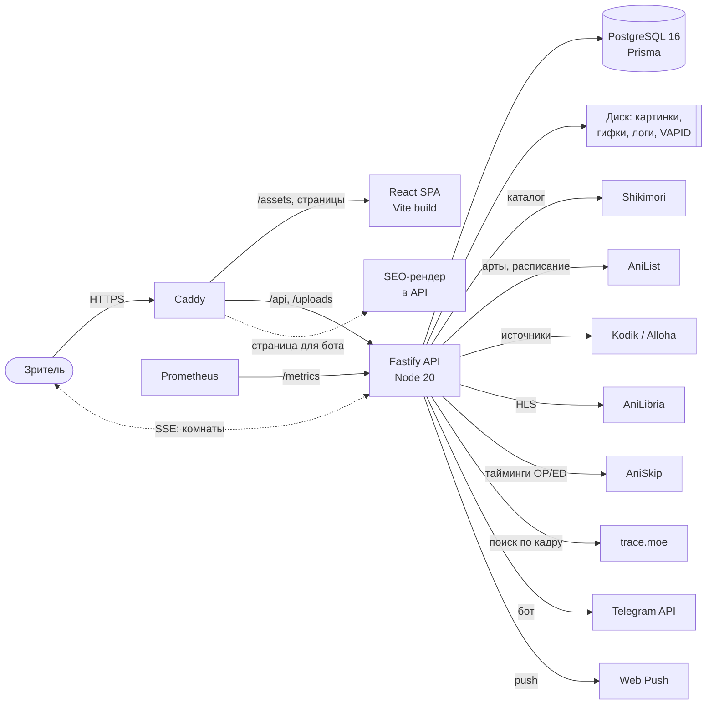
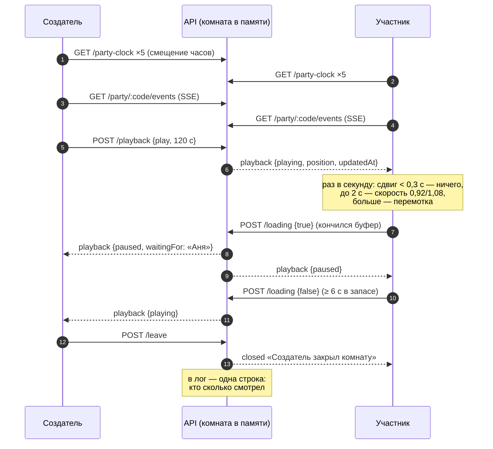
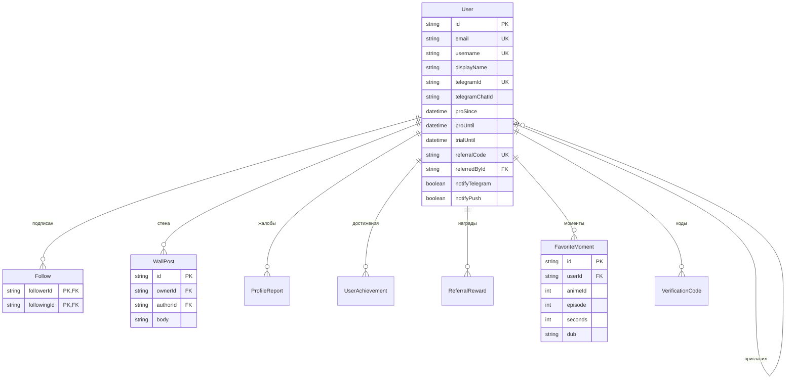
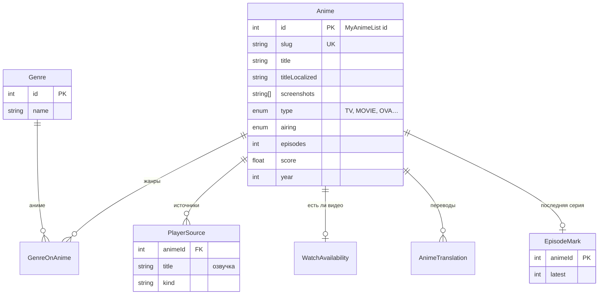
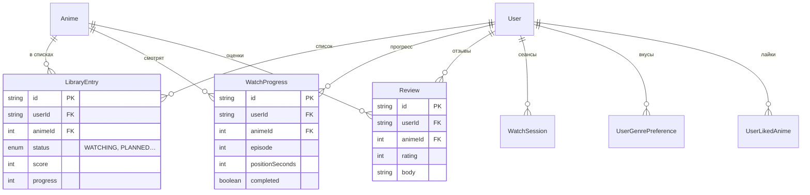
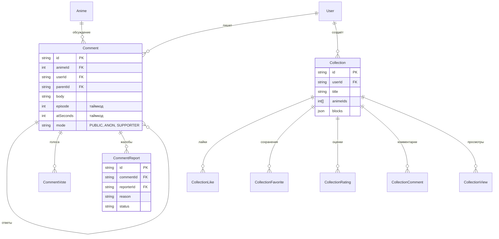
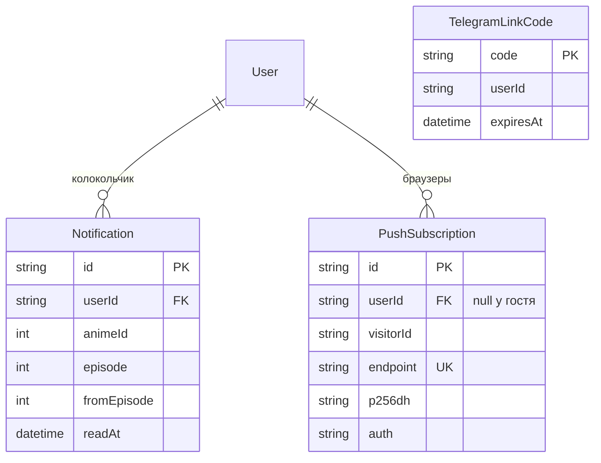
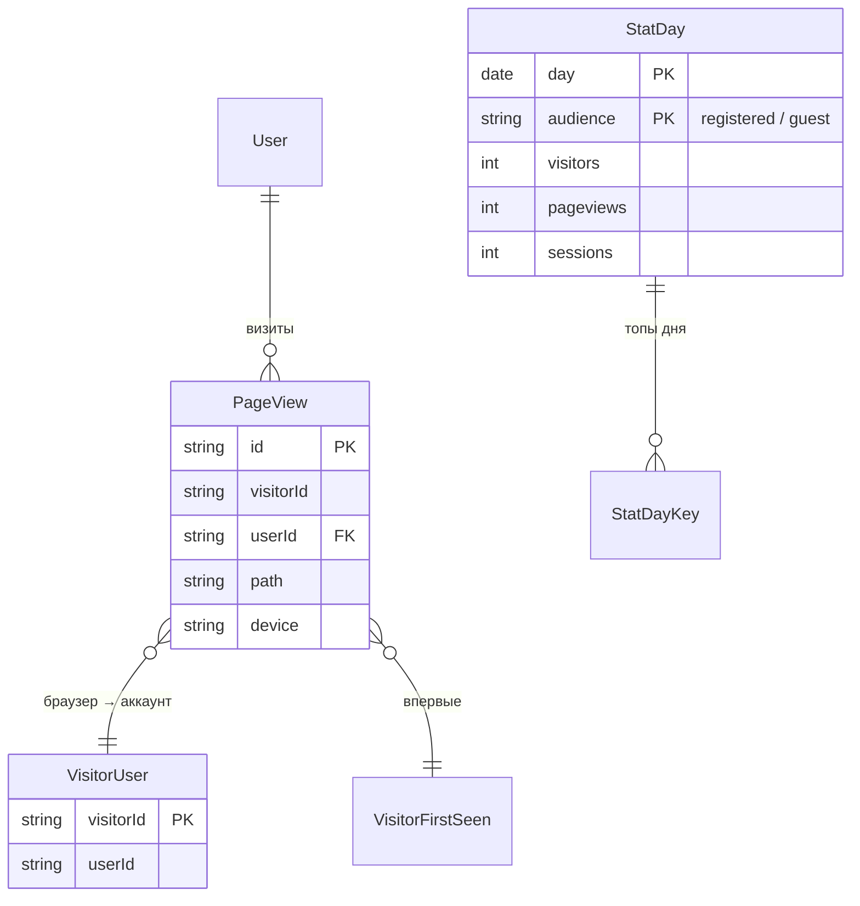

<a id="top"></a>

<div align="center">


# 影 AnimeShadow

### Аниме-кинозал: находи, смотри, отслеживай, обсуждай — и смотри вместе

[**animeshadow.online**](https://animeshadow.online)

[](https://www.typescriptlang.org/)
[](https://react.dev/)
[](https://vite.dev/)
[](https://tailwindcss.com/)
<br />
[](https://fastify.dev/)
[](https://www.postgresql.org/)
[](https://www.prisma.io/)
[](https://pnpm.io/)
<br />
[](https://caddyserver.com/)
[](https://prometheus.io/)
[](https://core.telegram.org/bots/api)

[Возможности](#-возможности) · [Архитектура](#%EF%B8%8F-архитектура) · [База данных](#%EF%B8%8F-база-данных) · [Быстрый старт](#-быстрый-старт) · [API](#-api) · [Деплой](#-деплой) · [English](#-in-english)

</div>

---

## ✨ Возможности

<table>
<tr>
<td width="50%" valign="top">

### 🎬 Просмотр
- **Свой HLS/MP4-плеер**: Kodik, AniLibria и открытый API AnimeVost; качество, скорость, PiP, жесты, горячие клавиши
- Подготовка короткого буфера на входе без автозапуска, старт одним нажатием
- Превью кадров на дорожке, отметки опенинга, эндинга и пересказа
- **Точный пропуск OP/ED** (AniSkip) под длину конкретной серии
- **Мгновенная следующая серия**: подгружается заранее, старт меньше чем за 0,5 с
- Режим **слабого интернета** и плашка скорости: «нужно ~1 Мбит/с, у вас 0,9»
- Фильтры картинки: ярче, сочнее, «старое аниме», ночной
- Прямой HLS Kodik и AniLibria в собственном плеере; переключение озвучек и серий без iframe
- Качества 1080p и 2K (1440p) для PRO; при отсутствии такого потока — масштабирование на GPU

</td>
<td width="50%" valign="top">

### 👥 Смотреть вместе
- Комнаты **до 10 человек**: пауза, перемотка и серия общие для всех
- Часы сверяются с сервером, мелкий рассинхрон догоняется плавно, без рывков
- **Ждём отстающих**: пауза у всех, пока у кого-то грузится
- Чат: смайлики, анимированные стикеры, гифки, реакции поверх видео
- «Что смотрим дальше»: предложения и голосование, автопереход
- Создатель управляет комнатой: видимость, «тихий режим», заглушить участника
- Список открытых комнат, приглашение по QR-коду, Telegram и push

</td>
</tr>
<tr>
<td valign="top">

### 📚 Каталог и поиск
- Возобновляемый импорт до 20 000 уникальных карточек: `pnpm catalog:expand`; [настройка источников](docs/player-sources.md)
- Shikimori, AniList и Kodik; расписание онгоингов на неделю
- **Умный поиск**: название, персонаж, настроение («грустное про космос»), сюжет
- Поиск **по кадру** (trace.moe) с очередью и кешем
- Подборки пользователей с лайками, рейтингом и комментариями
- Рекомендации по вашему списку и любимым жанрам

</td>
<td valign="top">

### 🔔 Уведомления
- Новые серии из «Смотрю», «В планах» и «Отложено»
- **Колокольчик** на сайте, **Telegram-бот** (`/start`, `/stop`, `/status`)
- **Web Push**, в том числе для гостей, без регистрации
- Ключи VAPID создаются сервером сами при первом запуске

</td>
</tr>
<tr>
<td valign="top">

### 🧑‍🎤 Профиль и сообщество
- Уровни, звания, рамки аватара, достижения (в том числе секретные)
- «Моя пятёрка» и **любимые моменты** с таймкодом и озвучкой
- Подписки, друзья, стена, жалобы, приватность по частям профиля
- Комментарии как на YouTube, комментарии **с таймкодом** (точки на дорожке)
- Реферальная программа и PRO

</td>
<td valign="top">

### 🛠️ Админка и SEO
- Посещаемость **по людям**, а не по браузерам, по московским суткам
- Журнал сервера (почасовые сводки), модерация, жалобы, статистика комнат
- Серверный рендер страниц для поисковиков: заголовки, Open Graph, schema.org
- sitemap с картинками, FAQ-разметка, IndexNow, `Clean-param` для Яндекса

</td>
</tr>
</table>

---

## 🏗️ Архитектура



**Монорепозиторий на pnpm workspaces:**

```
AnimeShadow/
├── apps/
│   ├── api/            # Fastify: маршруты, сервисы, SEO-рендер, фоновые задачи
│   └── web/            # React 19 + Vite + Tailwind v4: SPA
├── packages/
│   ├── db/             # Prisma-схема, миграции, клиент
│   ├── shared/         # zod-схемы и типы, общие для фронта и бэка
│   ├── shikimori/      # клиенты внешних API
│   ├── anilist/
│   ├── anilibria/
│   ├── kodik/
│   ├── alloha/
│   └── animethemes/
├── deploy/             # Caddyfile, systemd-юнит, setup.sh, deploy.sh, Prometheus
└── docker-compose.yml  # Postgres для разработки
```

<details>
<summary><b>🔄 Как синхронизируется комната совместного просмотра</b></summary>



</details>

---

## 🗄️ База данных

PostgreSQL 16 через Prisma. **44 модели**: схема в [`packages/db/prisma/schema.prisma`](packages/db/prisma/schema.prisma), миграции в [`packages/db/prisma/migrations`](packages/db/prisma/migrations). Ниже схема по разделам. Комнаты совместного просмотра в базе **не хранятся**: они живут в памяти API и после закрытия оставляют только строку в логе.

### Пользователи и сообщество



### Каталог



### Просмотр и список



### Комментарии и подборки



### Уведомления



### Аналитика



<details>
<summary><b>📋 Все модели</b></summary>

| Раздел | Модели |
|---|---|
| Аккаунт | `User`, `VerificationCode`, `PendingRegistration`, `TelegramLinkCode` |
| Сообщество | `Follow`, `WallPost`, `ProfileReport`, `ProfileVisit`, `ReferralReward`, `UserAchievement`, `FavoriteMoment` |
| Каталог | `Anime`, `Genre`, `GenreOnAnime`, `AnimeTranslation`, `PlayerSource`, `WatchAvailability`, `EpisodeMark`, `SyncState` |
| Просмотр | `LibraryEntry`, `WatchProgress`, `WatchSession`, `GuestWatchSession`, `Review`, `UserGenrePreference`, `UserLikedAnime` |
| Обсуждения | `Comment`, `CommentVote`, `CommentReport` |
| Подборки | `Collection`, `CollectionLike`, `CollectionFavorite`, `CollectionRating`, `CollectionComment`, `CollectionView` |
| Уведомления | `Notification`, `PushSubscription` |
| Аналитика | `PageView`, `VisitorUser`, `VisitorFirstSeen`, `StatDay`, `StatDayKey`, `SearchLog` |
| Игры | `GuessScore` |

</details>

---

## 🚀 Быстрый старт

> Нужны **Node ≥ 20.11**, **pnpm** и **Docker** (для Postgres).

```bash
git clone https://github.com/<you>/AnimeShadow.git
cd AnimeShadow
cp .env.example .env        # заполните JWT_SECRET и токены
pnpm setup                  # install → Postgres → prisma → пакеты → миграции → сиды
pnpm dev                    # API :4000 + сайт :5173
```

Откройте **http://localhost:5173**. Postgres слушает порт **5433**, чтобы не мешать локальной установке.

### 📜 Скрипты

| Команда | Что делает |
|---|---|
| `pnpm dev` | API и сайт с горячей перезагрузкой |
| `pnpm build` | Prisma-клиент и сборка всех пакетов и приложений |
| `pnpm typecheck` / `pnpm lint` | Проверка типов / ESLint |
| `pnpm db:up` / `pnpm db:down` | Поднять / остановить Postgres в Docker |
| `pnpm db:migrate` | Применить миграции |
| `pnpm db:studio` | Prisma Studio: база в браузере |
| `pnpm db:grant-pro` | Выдать PRO аккаунту |

### 🔐 Переменные окружения

Полный список с комментариями в [`.env.example`](.env.example).

| Переменная | Зачем |
|---|---|
| `DATABASE_URL` | Подключение к Postgres |
| `JWT_SECRET` | Подпись токенов входа (≥ 32 символа) |
| `APP_URL`, `CORS_ORIGINS` | Адрес сайта для ссылок и CORS |
| `KODIK_API_TOKEN` | Источники видео Kodik |
| `TELEGRAM_BOT_TOKEN` | Вход через Telegram и бот уведомлений |
| `VAPID_*` | Ключи Web Push (если не заданы, создаются сами в `data/vapid.json`) |
| `RESEND_API_KEY`, `EMAIL_FROM` | Письма с кодами |
| `TRACE_MOE_API_KEY` | Больше квоты для поиска по кадру |
| `YANDEX_VERIFICATION`, `GOOGLE_SITE_VERIFICATION` | Подтверждение в Вебмастере и Search Console |
| `INDEXNOW_KEY` | Мгновенное оповещение поисковиков |
| `LOG_DIR`, `LOG_KEEP_DAYS` | Где и сколько хранить сводки логов |

---

## 🔌 API

Все маршруты под `/api`. Схемы входа и выхода описаны zod-схемами в `packages/shared`.

| Группа | Примеры |
|---|---|
| Каталог | `GET /anime/:id`, `/anime/:id/watch`, `/anime/:id/skip-times`, `/search`, `/schedule` |
| Аккаунт | `POST /auth/register`, `/auth/login`, `/auth/telegram`, `GET /auth/me` |
| Список и прогресс | `/library`, `/progress`, `/me/continue` |
| Сообщество | `/comments`, `/comments/:id/report`, `/anime/:id/comment-marks`, `/users/:id/social` |
| Уведомления | `/me/notifications`, `/me/notify-settings`, `/me/telegram/link`, `/push/subscribe` |
| Совместный просмотр | `POST /party`, `GET /party`, `GET /party/:code/events` (SSE), `/playback`, `/loading`, `/chat`, `/queue` |
| Картинки | `GET /img?u=…&w=640&wm=1&f=jpg` (уменьшение, водяной знак, JPEG для превью) |
| SEO | `/seo/page/*`, `/seo-files/robots.txt`, `/seo-files/sitemap.xml` |
| Служебное | `/health`, `/metrics` (Prometheus), `/admin/*` |

---

## 🚢 Деплой

Production: Ubuntu, **Caddy** (HTTPS, раздача статики, прокси `/api`), **systemd** для API, Postgres.

```bash
# первый раз, на чистом сервере
bash deploy/setup.sh

# каждое обновление
git push origin main
ssh root@<server>
cd /var/www/animeshadow && bash deploy/deploy.sh
```

`deploy.sh` подтягивает код, ставит зависимости, применяет миграции, собирает, проверяет новую сборку на запасном порту и только после этого перезапускает API.

---

## 🔒 Безопасность

- Пароли хранятся в виде **bcrypt**-хешей; токены **JWT** с версией (выход со всех устройств).
- Жёсткая **CSP**, `helmet`, rate-limit на каждом изменяющем маршруте.
- Токены провайдеров никогда не попадают на фронтенд.
- 18+ закрыто подтверждением возраста; Rx не показывается никогда.
- Видео сайт **не хранит**: потоки отдают сторонние провайдеры в момент просмотра.

---

<a id="-in-english"></a>

## 🇬🇧 In English

**AnimeShadow** is a dark, cinema-styled anime catalogue and player: Shikimori/AniList/Kodik catalogue, a custom HLS player (exact OP/ED skipping via AniSkip, instant next episode, low-bandwidth mode, frame previews), **watch parties for up to 10 people** (server-synced clocks, smooth drift correction, waiting for the slowest viewer, chat with stickers/GIFs, a vote-driven "what's next" queue), new-episode notifications via a Telegram bot and Web Push, rich profiles with levels and achievements, YouTube-style and time-coded comments, and server-rendered SEO pages.

**Stack:** React 19 · Vite · Tailwind v4 · Fastify 5 · PostgreSQL 16 · Prisma · pnpm workspaces · Caddy · Prometheus.

```bash
cp .env.example .env && pnpm setup && pnpm dev   # → http://localhost:5173
```

---

<div align="center">

Сделано с ❤️ для тех, кто смотрит аниме

[⬆ Наверх](#top)

</div>
