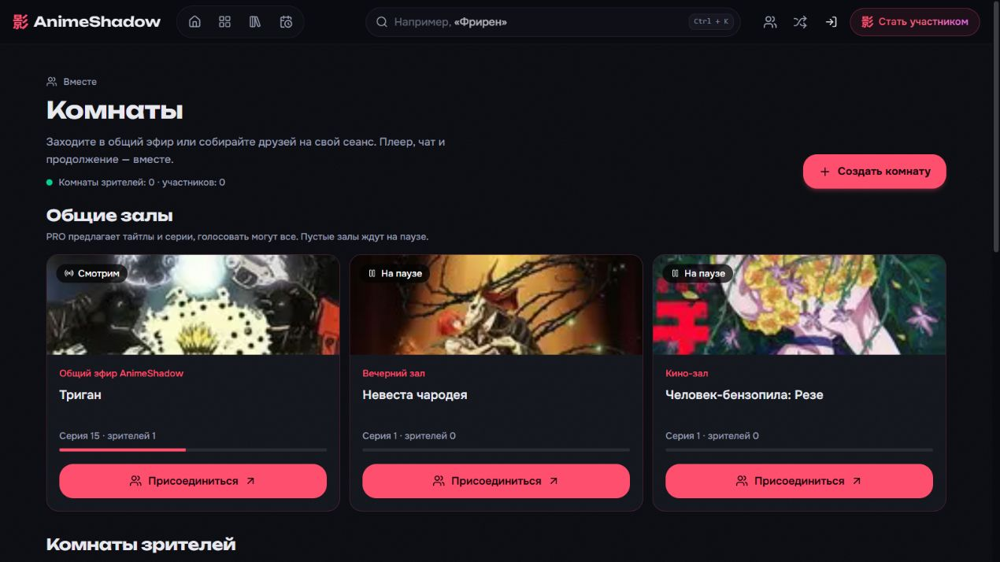

# Общие залы, голосования и история чата

Изменения локальные. На animeshadow.online не опубликованы.

- На странице комнат доступны три постоянных зала: общий, вечерний, кино-зал. Начальные тайтлы различаются, а продолжение выбирается отдельно в каждом зале. Первоначальный выбор кино-зала — фильм; после голосования зрители могут выбрать любой доступный тайтл.
- PRO-пользователь предлагает тайтл и номер серии. Проверка подписки выполняется сервером заново. Все участники могут голосовать за предложение или следующую доступную серию. На человека один активный голос; при равенстве сохраняется продолжение текущего тайтла. Победитель включается после окончания текущей серии.
- Предложение может содержать другую серию того же аниме. Номер проверяется по реально полученным прямым источникам, не по плановому количеству серий. Для одного тайтла в очереди может быть одно предложение; для изменения серии сначала убирается старое.
- Пустой общий зал немедленно ставится на паузу и сохраняет секунду. Сервер не переключает серии и не запрашивает новые источники по таймеру для пустого зала. Периодические записи пустых комнат в базу пропускаются. При возвращении участника просмотр продолжается с сохранённой позиции. После перезапуска сервера комнаты тоже ждут зрителя на паузе.
- Личные комнаты сохраняют прежние правила: участники могут остаться без создателя, полностью пустая комната ждёт 5 минут, ни разу не посещённая — час.
- Новый участник получает последние 120 сообщений в начальном событии. Дополнительный запрос истории после подключения объединяется по ID с новыми сообщениями без дубликатов. История сохраняется вместе с комнатой и восстанавливается после перезапуска. Чат прокручивается к последнему сообщению без тяжёлого плавного скролла; чтение старых сообщений не сбивается.
- Исправлена ложная ошибка «нет доступного потока»: выбор больше не требует сохранённой HLS/MP4-записи в базе и не отбрасывает рабочий динамический поток из-за старого флага стабильности или отсутствия длительности в каталоге. Используется тот же WatchService, что на странице аниме, с коротким ожиданием ещё загружающихся источников. При неизвестной длительности окончание сообщает активный плеер с проверкой текущего тайтла, серии и серверной позиции.
- Каталог залов не передаёт историю чата каждые 15 секунд. Застывшие карточки не запускают покадровые таймеры. Гифки чата на сенсорном экране показывают статичное изображение, кадры истории загружаются лениво.

## Проверки

49 автоматических тестов прошли. Добавлены проверки трёх независимых залов, отсутствия фоновых запросов при пустом зале, остановки/возобновления времени, PRO-предложений, выбора третьей серии, истории нового участника и динамического потока без записи HLS в базе.

Реальная интеграционная проверка подключила двух временных пользователей к личной комнате: сообщение первого пришло второму в начальном событии и отдельной истории; уход создателя сохранил комнату, управление перешло бесплатному участнику, позиция сохранилась в базе. Временные пользователи удалены, внешних уведомлений не отправлено.

Типы web/API, сборки и целевой ESLint проверены. Браузер показывает все три карточки и состояния «Смотрим»/«На паузе».

Дополнительно в интерфейсе временный PRO-аккаунт предложил «Человек-бензопила: Резе» в вечернем зале: предложение принято, затем удалено. Просмотр в общем зале запустился с серверной позиции: `readyState=4`, изображение 1280×720, позиция 131 секунда. После выхода тестового участника зал вернулся на паузу. Для запросов сохранения учитывались рекомендации Prisma Client API; новая таблица не создавалась.

Новая миграция не требуется: используется существующее сохранение `WatchPartyRoom`. Для публикации нужны обе сборки. Наличие источника в ответе провайдера не гарантирует доступность его CDN из любой сети; при ошибке можно обновить источники или выбрать другой доступный вариант.
