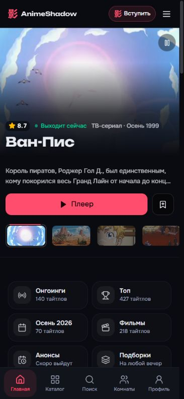
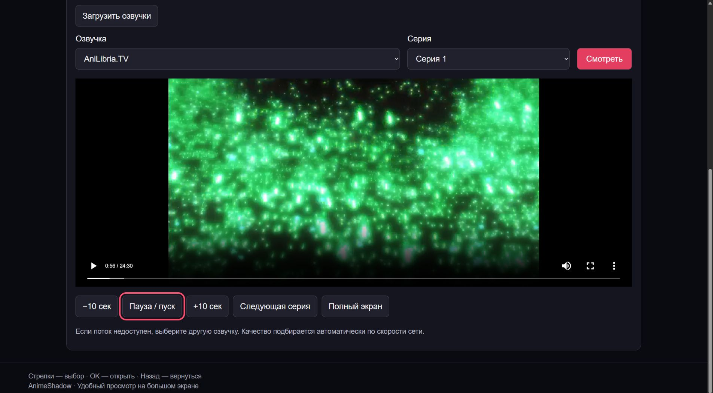

# Телефон, производительность и Samsung TV 2020

Изменения локальные. На animeshadow.online не опубликованы. Основные цвета, логотип и стиль сайта сохранены.

Продолжение работы над общими залами: [ROOMS-VOTING-2026-10-17.md](./ROOMS-VOTING-2026-10-17.md). После этих изменений полный набор содержит 49 проходящих тестов.

## Телефон

- Нижняя панель на всю ширину, пять равных кнопок с постоянными подписями. Нажатие не раздвигает меню и не уменьшает иконки. Высота панели 64 px плюс безопасная зона и граница.
- В настройках аккаунта можно переместить поиск на любую позицию. Поиск нельзя удалить. Старые настройки из четырёх ярлыков читаются с сохранением выбранных разделов. Тот же компонент используется для интерактивного предпросмотра.
- Хэдер, боковое меню и кнопка закрытия учитывают верхнюю безопасную зону. Отдельный фон закрывает область системной строки при скрытом хэдере.
- На узких экранах убрана дублирующая кнопка поиска из хэдера; поиск остаётся в нижнем меню. Случайный выбор на телефоне доступен в бургере.
- Хэдер скрывается вниз и появляется вверх. Открытое меню удерживает его на месте. Убрано принудительное появление из-за CSS `:has(:focus-visible)` после закрытия окна.

## Меньше лишней работы

- Главный слайдер больше не монтирует видео и не запрашивает видеопредпросмотр. Фотографии сменяются каждые четыре секунды; при скрытой вкладке или выходе за экран таймер остановлен. Кнопка «Плеер» ведёт к собственному плееру тайтла.
- Карточки больше не поднимаются и не анимируют большую тень. Остаётся подсветка границы. Убрана дублирующая предварительная загрузка страницы; наведение проверяется с задержкой 150 ms и только для точного указателя.
- На сенсорных устройствах отключены циклы частиц, сияния, эмблем, приглашений и ряда эффектов профиля, а также анимация перехода всей страницы. Индикаторы загрузки и прогресса плеера сохранены.
- Гифки библиотеки на сенсорных устройствах и при reduced motion отображаются статичными WebP. Их предварительная загрузка на телефоне отключена.

## Samsung TV 2020

По [таблице Samsung](https://developer.samsung.com/smarttv/develop/specifications/web-engine-specifications.html), телевизоры 2020 года используют Tizen 5.5 / Chromium 69. Основная сборка содержит ES2022 и Tailwind 4. [Tailwind 4 требует существенно более нового браузера](https://tailwindcss.com/docs/upgrade-guide). Это вероятная причина несовместимости; точный сбой на физическом устройстве не диагностировался.

Добавлен режим `/tv`, не зависящий от React, Tailwind, модулей JavaScript и основного приложения:

- Каталог по 24 карточки, поиск по русскому/английскому/основному названию, крупные элементы и видимый фокус пульта. Отбираются тайтлы с сохранённой доступностью собственного плеера; это не гарантия доступности каждого внешнего CDN в момент просмотра.
- Собственный HTML5-плеер, озвучки загружаются при открытии, выбираются реальная озвучка и существующая серия. Чужие iframe и рекламные виджеты не монтируются.
- Прямые MP4 и HLS через локально поставляемый HLS.js Light. При отсутствии подходящего MediaSource используется нативное HLS, если браузер его объявляет. Буфер ограничен; качество адаптируется автоматически.
- Стрелки/OK, назад, воспроизведение/пауза, ±10 секунд, кнопки перемотки пульта ±30 секунд, следующая серия, полный экран. Позиция сохраняется локально для тайтла, озвучки и серии.
- Ошибка и тайм-аут потока показывают понятное сообщение. Каталог и ошибки страниц оформлены даже без запуска JavaScript.
- Samsung/Tizen автоматически направляется сюда на сервере до загрузки основного приложения; адрес аниме сохраняется. В Vite реализовано то же поведение. В футере есть ссылка «Версия для ТВ».
- «Обычная версия» отключает автоматический перевод на 30 дней в этом браузере. Ручной переход на `/tv` остаётся доступен.

Режим предназначен для каталога и просмотра. Комнаты и настройки аккаунта остаются в основном приложении. Samsung AVPlay не использован: это сайт во встроенном браузере, а не установленное Tizen-приложение.

## Проверки

- 47 тестов плеера, комнат, уведомлений, меню и ТВ-клиента прошли. ТВ-клиент проверен парсером ES5; поставляемый HLS.js — синтаксисом ES2018, доступным Chromium 69.
- `scripts/check-navigation.ts`: реальное сохранение, повторный вход, изоляция аккаунтов, запрет дубликатов и отсутствующего поиска; временные пользователи удалены.
- `scripts/check-tv.mjs`: перенаправления Samsung в Vite и серверном HTML, сохранение тайтла, отказ от автоматического ТВ-режима, экранирование поиска, страницы каталога/тайтла/404/422, локальные стили и движок, только прямые источники.
- Браузер 320/375 px: нет переполнения, пять равных кнопок, поиск открывается, боковое меню доступно, хэдер скрывается вниз и появляется вверх. В слайдере ноль элементов `video`.
- Браузер 1920×1080: поиск в ТВ-каталоге, открытие аниме, выбор стрелками, реальное воспроизведение двух источников («AniLibria» и «AniLibria.TV») для «Невесты чародея», пауза и +10 секунд. Оба видео имели `readyState=4`, буфер и изображение 1280×720.
- Сборки web/API и проверка типов проходят. У целевой проверки ESLint нет ошибок; Vite-конфигурация исключена общим правилом проекта и проверяется сборкой.

Физический Samsung недоступен. Кодеки, сертификаты и доступность CDN из сети телевизора требуют проверки на самом устройстве. Современный браузер не заменяет такую проверку.

## Публикация

Нужны обе сборки и обновлённый `deploy/Caddyfile`: `/tv` и `/tv/*` должны идти в API. В web-сборке должны присутствовать `tv.css`, `tv.js`, `tv-hls.js`. Новая миграция для этой работы не требуется; миграция настроек меню из предыдущей версии должна быть применена.
